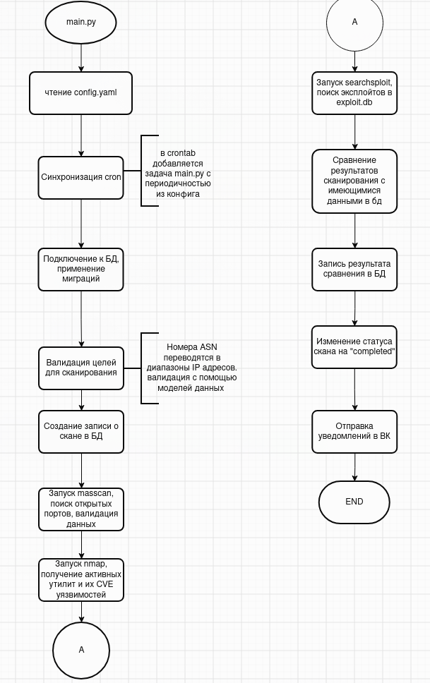
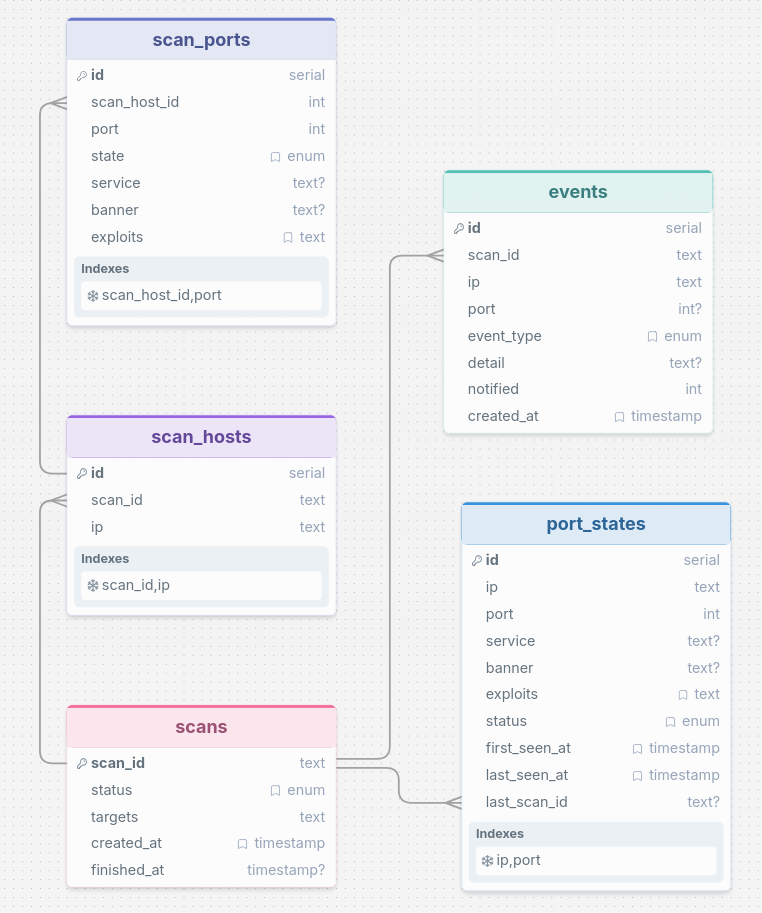

# Port Scanner

Сканер открытых портов с историей изменений, поиском сведений об уязвимостях, уведомлениями ВКонтакте и веб-дашбордом.



## Возможности

- Принимает IP-адреса, CIDR-диапазоны и номера ASN в качестве целей.
- Находит открытые порты через Masscan, определяет службы через Nmap и обрабатывает результаты скрипта `vulners`.
- Ищет записи Exploit-DB по найденным CVE через SearchSploit.
- Сохраняет сканирования, состояние портов и события изменений в SQLite.
- Отправляет новые события администратору через сообщения VK, если указаны реквизиты бота.
- Показывает результаты и историю событий в Streamlit.

## Требования

- Linux, Python 3.10+ и `pip`.
- Установленные утилиты `masscan`, `nmap`, `searchsploit` (Exploit-DB), `whois` (для ASN) и `crontab`.
- Доступ Masscan к raw-сокетам. Например, администратор может выдать бинарнику capabilities:

  ```bash
  sudo setcap cap_net_raw,cap_net_admin+eip "$(command -v masscan)"
  ```

- Скрипт Nmap `vulners` должен быть установлен отдельно, если нужны сведения о CVE.

Сканируйте только системы, на проверку которых у вас есть разрешение.

## Быстрый старт

```bash
git clone https://github.com/Leshyyyy/Port-scanner.git
cd Port-scanner
python3 -m venv .venv
source .venv/bin/activate
python -m pip install -r requirements.txt
cp .env.example .env
cp config/config.example.yaml config/config.yaml
```

Заполните `scanner.targets` в `config/config.yaml` своими адресами или диапазонами. При необходимости измените порты, скорость, сетевой интерфейс и время ожидания. Значение `interface: null` включает автоматический выбор интерфейса.

В `.env` задан общий путь `DB_PATH=database/scanner.db` для сканера и дашборда. Для уведомлений добавьте `VK_BOT_TOKEN` и `VK_ADMIN_ID`; без них сканирование работает, но сообщения не отправляются.

Запуск одного сканирования:

```bash
python main.py
```

Запуск дашборда из корня проекта:

```bash
streamlit run app/app.py
```

Streamlit выведет адрес страницы в терминал. Дашборд показывает последнюю проверку, события и известные открытые порты.

## Конфигурация

| Параметр | Назначение |
| --- | --- |
| `scanner.targets` | Список IP, CIDR или ASN, например `AS64496`. |
| `scanner.ports` | Порты Masscan, например `22,80,443` или `1-1024`. |
| `scanner.rate` | Скорость отправки пакетов Masscan. |
| `scanner.interface` | Имя интерфейса или `null` для автоматического выбора. |
| `scanner.wait_time` | Ожидание ответов Masscan в секундах. |
| `schedule` | Поля cron для предполагаемого расписания. |

Сейчас `main.py` формирует строку cron, но `set_crontab()` в `utils/cron_manager.py` не записывает её. Для периодического запуска настройте cron вручную, например:

```cron
0 */6 * * * cd /path/to/Port-scanner && /path/to/Port-scanner/.venv/bin/python main.py
```

## Структура проекта

| Путь | Содержимое |
| --- | --- |
| `main.py` | Запуск сканирования и отправка уведомлений. |
| `utils/` | Подготовка целей, сканирование и сравнение состояний. |
| `database/` | Работа с SQLite и SQL-миграции. |
| `bot/` | Форматирование и отправка сообщений VK. |
| `app/` | Дашборд Streamlit. |
| `config/` | Настройки и конфигурация логирования. |
| `ProjectSchema.png`, `DBDiagram.png` | Схемы проекта и базы данных. |



Локальные `.env`, `config/config.yaml`, база SQLite, логи, виртуальное окружение и кэш Python исключены из Git. Для повторного запуска достаточно шаблонов конфигурации и миграций.
